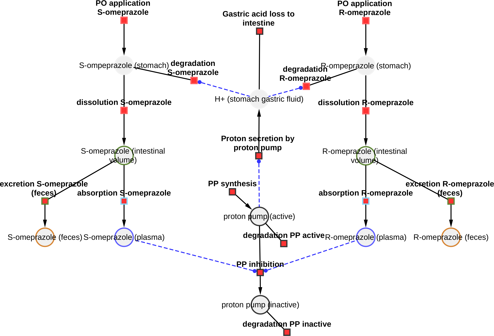
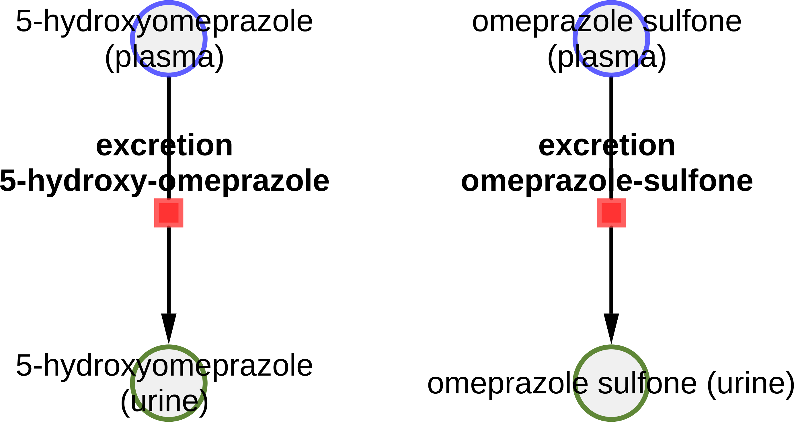

# Models

The models are distributed in [SBML](http://sbml.org) format.

## omeprazole_body

* Model: [`omeprazole_body.xml`](https://raw.githubusercontent.com/matthiaskoenig/omeprazole-model/main/models/omeprazole_body.xml)
* Equations: [`omeprazole_body.md`](https://github.com/matthiaskoenig/omeprazole-model/blob/main/models/omeprazole_body.md)
* Report: [SBML4humans](https://sbml4humans.de/report?url=https%3A%2F%2Fraw.githubusercontent.com%2Fmatthiaskoenig%2Fomeprazole-model%2Fmain%2Fmodels%2Fomeprazole_body.xml)

## omeprazole_body_flat

* Model: [`omeprazole_body_flat.xml`](https://raw.githubusercontent.com/matthiaskoenig/omeprazole-model/main/models/omeprazole_body_flat.xml)
* Equations: [`omeprazole_body_flat.md`](https://github.com/matthiaskoenig/omeprazole-model/blob/main/models/omeprazole_body_flat.md)
* Report: [SBML4humans](https://sbml4humans.de/report?url=https%3A%2F%2Fraw.githubusercontent.com%2Fmatthiaskoenig%2Fomeprazole-model%2Fmain%2Fmodels%2Fomeprazole_body_flat.xml)

## omeprazole_intestine

* Model: [`omeprazole_intestine.xml`](https://raw.githubusercontent.com/matthiaskoenig/omeprazole-model/main/models/omeprazole_intestine.xml)
* Equations: [`omeprazole_intestine.md`](https://github.com/matthiaskoenig/omeprazole-model/blob/main/models/omeprazole_intestine.md)
* Report: [SBML4humans](https://sbml4humans.de/report?url=https%3A%2F%2Fraw.githubusercontent.com%2Fmatthiaskoenig%2Fomeprazole-model%2Fmain%2Fmodels%2Fomeprazole_intestine.xml)

{ style="max-height: 420px; width: auto; max-width: 100%" }

## omeprazole_kidney

* Model: [`omeprazole_kidney.xml`](https://raw.githubusercontent.com/matthiaskoenig/omeprazole-model/main/models/omeprazole_kidney.xml)
* Equations: [`omeprazole_kidney.md`](https://github.com/matthiaskoenig/omeprazole-model/blob/main/models/omeprazole_kidney.md)
* Report: [SBML4humans](https://sbml4humans.de/report?url=https%3A%2F%2Fraw.githubusercontent.com%2Fmatthiaskoenig%2Fomeprazole-model%2Fmain%2Fmodels%2Fomeprazole_kidney.xml)

{ style="max-height: 420px; width: auto; max-width: 100%" }

## omeprazole_liver

* Model: [`omeprazole_liver.xml`](https://raw.githubusercontent.com/matthiaskoenig/omeprazole-model/main/models/omeprazole_liver.xml)
* Equations: [`omeprazole_liver.md`](https://github.com/matthiaskoenig/omeprazole-model/blob/main/models/omeprazole_liver.md)
* Report: [SBML4humans](https://sbml4humans.de/report?url=https%3A%2F%2Fraw.githubusercontent.com%2Fmatthiaskoenig%2Fomeprazole-model%2Fmain%2Fmodels%2Fomeprazole_liver.xml)

{ style="max-height: 420px; width: auto; max-width: 100%" }

## COMBINE archive

The models and the metadata are available as COMBINE archive from [`omeprazole_model.omex`](https://raw.githubusercontent.com/matthiaskoenig/omeprazole-model/main/omeprazole_model.omex).
